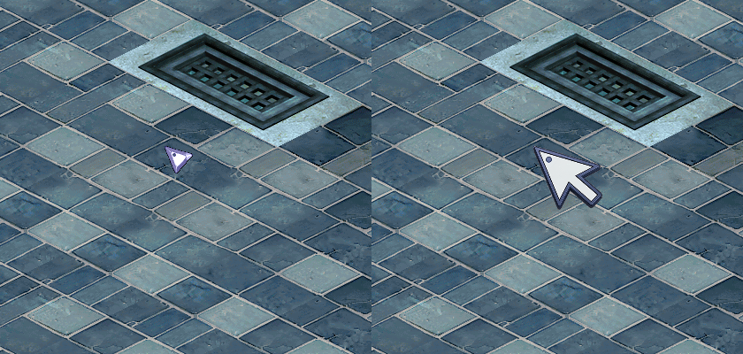

# 🖱️ TalesWeaver Cursor Assistance

**TalesWeaver Cursor Assistance**는 온라인 게임 **테일즈위버(TalesWeaver)** 플레이를 더욱 편리하게 만들어주는 커서 및 스킬 범위 오버레이 유틸리티 프로그램입니다.

---

## 🖼️ 소개 및 미리보기 (Preview)

| 메인 컨트롤러 및 실행 화면 |
| :---: |
|  |

* 내년이면 벌써 24주년을 맞는 테일즈위버, 게임도 늙고 우리도 늙었습니다.
* 컴퓨터는 알아서 잘 돌아가지만, 화면을 바라보는 우리의 소중한 눈은 이미 많이 혹사당한 상태입니다.
* 대장간 사냥 같은 빡빡한 플레이 환경에서 눈의 피로를 조금이라도 줄여보고자, 시간빌게이츠백수가 해피아워까지 포기하고 작업했습니다.
* 외국 제작자(catnip5)의 마우스 하이라이트 프로그램을 개조하여 제작되었습니다. ([제작자 사이트 바로가기](https://sites.google.com/view/catnip5))
* 게임 플레이에 불필요한 기능들은 과감히 도려내고, 커서 크기, 투명도 조절, 커서 변경, 앱 시스템 트레이 최소화 등 필요한 기능만 직관적인 UI로 담았습니다.
* ⚠️ **참고 사항**: 창 모드 및 전체 창 모드(테두리 없는 창 모드)에서만 정상 작동하며, 단독 전체화면 모드는 지원하지 않습니다.

### 🔍 기능별 미리보기

| 커서 비교 |
| :---: |
|  |

| 창모드 지원 |
| :---: |
|  |

| 자기 중심 범위 |
| :---: |
|  |

| 직선 범위 |
| :---: |
|  |

| 지정 범위 |
| :---: |
|  |

---

## 🚀 시작하기 (Getting Started)

1. **다운로드**: [Releases 페이지](https://github.com/Bad-Factory/TalesWeaver_Cursor_Assistance/releases)에서 최신 버전을 다운로드합니다.
2. **실행**: `TalesWeaver_Cursor_Assistance.exe` 파일을 실행합니다.
3. **설정**: 
   * 원하는 커서 프리셋을 선택 또는 Base64 코드를 입력하고 **[커서 변경]** 을 누릅니다.
   * 사용할 스킬 범위 모드를 선택하고 범위값을 입력합니다.
   * **[설정값 저장]** 을 눌러 INI 파일에 설정을 저장합니다.
4. **최소화**: `ESC` 키 또는 **[트레이로 최소화]** 버튼을 눌러 트레이 상태로 게임을 즐깁니다.

---

## ✨ 주요 기능 (Key Features)

### 1. 커서 설정 및 커스텀 (Cursor Customization)
* **크기 및 투명도 조절**: 마우스 커서의 크기와 투명도를 자유롭게 조절할 수 있습니다.
* **클릭 시 크기 축소**: 마우스 버튼을 누르고 있는 동안 커서가 `90%` 크기로 축소되어 입력 피드백을 직관적으로 확인할 수 있습니다.
* **프리셋 지원**: 기본 커서 외에도 **옐로 커서(Yellow)**, **레드 커서(Red)** 프리셋을 손쉽게 전환할 수 있습니다.
* **Base64 커스텀 이미지**: 원하는 이미지(CUR/PNG 등)를 Base64 문자열로 변환하여 자신만의 커서로 실시간 적용할 수 있습니다.

### 2. 스킬 범위 오버레이 (Skill Range Overlay)
게임 내 스킬 시전 위치와 타격 범위를 화면에 시각적으로 표시하여 정확한 타겟팅을 돕습니다.
* **자기 중심 범위**: 플레이어 캐릭터 중심의 마름모 형태 범위 표시 (예프넨 등 직업별 기본값 지원)
* **직선 범위**: 직선형 스킬의 범위 및 사거리 표시
* **지정 범위**: 마우스 커서를 따라다니는 원형 지정 범위 표시
* **특성 및 아이템 연동**: 
  * **범위 연마** 체크 시 범위 자동 확장 (+20)
  * **불시엔** 아이템 효과 연동 (+7)
* **투명도 조절**: 사냥 시 시야를 방해하지 않도록 오버레이 투명도 슬라이더 조절 지원
* **색상 변경**: 범위 오버레이 색상을 자유롭게 변경 가능

### 3. 편의 기능 및 시스템 트레이
* **게임 실행 중에만 동작**: 테일즈위버 실행 여부를 감지하여 게임 실행 중에만 커서 및 범위 오버레이 표시를 할 수 있습니다.
* **트레이 최소화 (`ESC` / 버튼)**: 작업 표시줄에서 숨기고 시스템 트레이 아이콘으로 백그라운드 실행이 가능합니다.
* **INI 설정 저장**: 설정한 커서 크기, 투명도, 스킬 범위 및 모드 등의 설정값이 `TalesWeaver_Cursor_Assistance_config.ini` 파일로 저장됩니다.

### 4. Space -> Enter 치환

| 사용 예시 |
| :---: |
|  |

* 1~5키 입력 시 지정 시간 동안 입력키가 치환됩니다.
* 좌측 예시 화면에서 1키 입력 후 지정 시간내에 `Space` 키를 입력하면 `Enter` 키로 치환되어 빠른 진행이 가능합니다.

---

## 💡 참고 사항
* 본 프로그램은 Windows 환경에서 동작하며, 마우스 저수준 후크(`MouseHook`)를 사용하여 커서 위치를 추적합니다.
* 전역 저수준 키보드 후크(`WH_KEYBOARD_LL`)가 사용되므로, Windows 환경이나 대상 클라이언트(`InphaseNXD.exe`)의 권한/보안 환경에 따라 키 치환이나 오버레이 동작이 영향을 받을 수 있습니다.
* 사용자 커서 이미지는 [Base64 이미지 변환기](https://www.base64.sh/ko/image-to-base64/) 등을 통해 손쉽게 생성할 수 있습니다.
